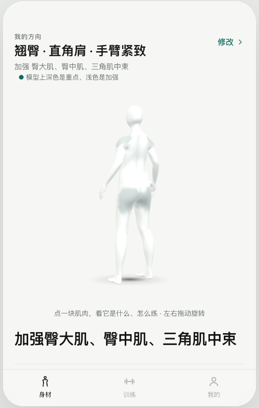

<h1 align="center">Anya (Wenyan) Li</h1>

  <b>Data Analyst · Singapore</b> 
  I turn messy product, campaign and on-chain data into decisions, and I build AI agents to automate the work in between.

  
  
  
  

---

## 🧰 Toolbox

| | |
|---|---|
| 📊 **Data & analysis** |       |
| 📈 **BI & tracking** |     |
| 🤖 **AI agents & building** |     |
| 🧪 **Methods** | A/B testing · multi-channel attribution · funnel analysis · segmentation · root-cause analysis · metric design |

---

## 🏆 Highlights from my work

**imToken** (Data Analyst, 2024 – now) · **Tencent** · **NetEase Games** · **ByteDance** · **TikTok**

| Impact | What I did |
|---|---|
| **2 weeks → 1 day** | Built an AI agent that automates chain and token listing across 3 teams, shipped to imToken's internal agent platform |
| **36%** | of campaign stakers credited to push, from a multi-channel attribution model I built for a Lido staking campaign |
| **5x** | conversion gap uncovered across 5 fiat on-ramp providers in 20+ countries, the basis of my payments growth proposal |
| **Settlement-ready** | Staking data, SQL and dashboard that Finance uses to settle revenue share with partners |
| **−25% · +15% CTR** | Fewer irrelevant results on a 30K-user search service after my root-cause analysis at Tencent |
| **+47% · +18% GMV** | Merchant onboarding and UK GMV growth my incentive redesign contributed to at TikTok Shop |

---

## 🛠️ Things I've built

I build tools for problems I actually have. I write the spec, make the product calls, test and ship, using Claude Code as my engineering partner.

### 🤖 [Asteron](https://github.com/anyali-1015/asteron-site): an AI trading agent that follows your plan · *hackathon*

Write your trading brief in plain language and Asteron executes it exactly as given on Hyperliquid.
- Runs the full loop from idea and backtest to live trading and review, where other tools cover only one piece
- Learns your preferences and market patterns over time
- Trilingual landing site (EN / 简 / 繁), currently on testnet

`AI agent` `Hyperliquid` `Claude Code`

 

### 💪 [BodyNav](https://github.com/anyali-1015/bodynav): AI body-proportion training planner · *hackathon, 🏆 Innovation Prize*

- Uses pose estimation (MediaPipe Pose) to detect body key points from a photo and compare proportions with your goal
- A transparent rule engine decides which muscle groups to prioritise, and every conclusion traces back to its rule and number
- Photos never leave the browser

`JavaScript` `MediaPipe` `Pose estimation` · 🔗 [Live demo](https://anyali-1015.github.io/bodynav/)

 

### 🗣️ [Tone](https://github.com/anyali-1015/tone): speak English like a native
An AI speaking coach for advanced learners.
- Role-play 6 everyday scenes out loud with an AI partner and get feedback, or ask "say it more natively" on any line
- Turn YouTube videos into interactive transcripts for looping and shadowing
- Saved-phrase notebook with spaced-repetition review (FSRS)

`Next.js` `TypeScript` `Gemini API` `IndexedDB`

<b>More side projects</b>

 

**🎬 [Video Digest](https://github.com/anyali-1015/video-digest): learn from YouTube and Bilibili.** A Chrome side panel with transcripts, bilingual translation, AI overviews, in-panel AI chat and timestamped notes exported to Markdown. Extended from [zarazhangrui/youtube-digest](https://github.com/zarazhangrui/youtube-digest) to support Bilibili.
`Chrome Extension MV3` `JavaScript` `LLM APIs`

**💡 [Inspo Pool](https://github.com/anyali-1015/inspo-pool): idea library for content creators.** Saves Xiaohongshu, Douyin and Instagram posts as tagged cards, bulk-collects high-performing titles with a bookmarklet, and runs on the web and as an iPhone app.
`Single-file web app` `Capacitor (iOS)` · 🔗 [Live app](https://anyali-1015.github.io/inspo-pool/)

**🎓 [Digital-human MOOC maker](https://github.com/anyali-1015/mooc-avatar).** Turns a slide deck and a short voice recording into a full video course with a cloned voice and lip-synced presenter, exported as MP4 with subtitles. I built it so my mother can publish her lectures.
`Python` `Streamlit` `LatentSync` `CosyVoice`

---

## 🌱 More about me

- 🎓 **MSc Technopreneurship & Innovation, NTU** (CGPA 4.06 / 5) · **BA Business English + Finance double degree, SUFE**, Project Lead of a national-champion entrepreneurship project (2021)
- 🗣️ Mandarin (native) · English (fluent, IELTS 8.0) · French (B2)
- 🚀 No CS degree, so I learn by shipping: everything above was built while working full-time
- 📱 Content creator with 20K followers across TikTok and Rednote (lifestyle and gym)
- 🎭 Broadway musicals (I can sing every song in *Hamilton*) · 🎾 tennis · 🥾 hiking

  📫 <b>Let's talk:</b> <a href="mailto:anya.li1015@gmail.com">anya.li1015@gmail.com</a> · <a href="https://www.linkedin.com/in/wenyanli-2023ntu/">LinkedIn</a>

