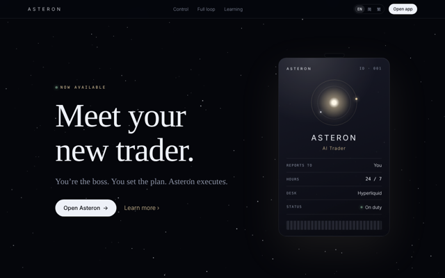

## Hi, I'm Anya (Wenyan Li) 👋

Data analyst in Singapore. I answer business questions with data: which campaign worked, where users drop off, what a partner is owed. SQL and Python across app, web and on-chain data, and I build my own tools with AI.

- Data Analyst at **imToken** (crypto wallet), Feb 2025 – now
- Before that: **Tencent** (Technical PM intern), **NetEase Games** (Data Scientist intern), **ByteDance** (Data PM intern), **TikTok** (Product Ops intern)
- MSc Technopreneurship & Innovation, **NTU** · BA Business English, **SHUFE**
- Open to data analyst, business analyst and product operations roles

### Toolbox

| | |
|---|---|
| 📊 **Data** |      |
| 📈 **BI & tracking** |    |
| 🤖 **Building with AI** |     |

---

## 📊 Selected analysis work

**Which channels actually drove a 935-ETH staking campaign?** · *imToken × Lido APY Boost, 2026*
Joined GA4 app and web events (BigQuery export) with campaign registrations and on-chain receipts, and built a 72-hour priority attribution model across push, message centre, X, banners and email. Push brought **44%** of the landing-page traffic uplift and **36%** of staking devices; most drop-off was users closing the pop-up, not failed delivery, so I recommended testing creative and timing next.

**What does each staking partner earn and owe?** · *imToken Web Staking, 2025 – 2026*
Wrote the BigQuery pipelines behind the staking finance dashboard and billing reports, including execution-layer rewards parsed from on-chain internal transactions. Finance runs partner revenue-share settlement from these reports.

**How do 29 games measure the same thing the same way?** · *NetEase Games, 2024*
Built 3 PySpark analysis frameworks with one definition each for DAU, retention and conversion, used across 29 games; delivered 52 data requests and 5 reports for Eggy Party and Identity V.

---

## 🛠️ Products I've built with AI

I'm not a software engineer by training. I write the spec, make the product calls, test and ship, with Claude Code doing most of the typing. Each project solves a problem I actually had.

### 🤖 [Asteron](https://github.com/anyali-1015/asteron-site): an AI trader that follows your plan · hackathon, team of two

You write the trading plan; Asteron executes it word for word.
- Entry rules, exits and drawdown limits run around the clock on Hyperliquid
- A memory and playbook that learn from each trade
- Trilingual landing site (EN / 简 / 繁); testnet only, no user funds on mainnet

`AI agent` `Hyperliquid` `HTML/CSS`

 

### 🗣️ [Tone](https://github.com/anyali-1015/tone): sound like a native English speaker
An English speaking coach for advanced learners.
- Practise 6 everyday scenes out loud with an AI partner; ask "say it more natively" on any line
- Turn YouTube videos into interactive transcripts for looping and shadowing
- Notebook of saved phrases with spaced-repetition review (FSRS)

`Next.js` `TypeScript` `Gemini API` `IndexedDB`

### 💪 [薄肌俱乐部 BodyNav](https://github.com/anyali-1015/bodynav): body-proportion training planner · hackathon team project

Take a full-body photo and see how your proportions compare with your goal.
- A transparent rule engine decides which muscle groups to prioritise, and every conclusion traces back to the rule and number behind it
- 3D body model: tap a muscle to see what it is and how to train it
- Auto-detects key points with MediaPipe Pose; photos never leave the browser

`HTML` `JavaScript` `MediaPipe` · 🔗 [Live demo](https://anyali-1015.github.io/bodynav/)

 

### 🎬 [Video Digest](https://github.com/anyali-1015/video-digest): learn from YouTube and Bilibili
A Chrome side panel that turns videos into study material.
- Transcripts, bilingual translation and AI overviews
- In-panel AI chat for any word or concept you don't understand
- Timestamped notes, exported to Markdown in one click
- A remix of [zarazhangrui/youtube-digest](https://github.com/zarazhangrui/youtube-digest), extended for Bilibili

`Chrome Extension MV3` `JavaScript` `LLM APIs`

### 💡 [灵感池 Inspo Pool](https://github.com/anyali-1015/inspo-pool): idea library for content creators
- Save Xiaohongshu, Douyin and Instagram posts as tagged cards
- Bulk-collect high-performing titles from a creator's page with a bookmarklet
- Photo references with notes; runs on the web and as an iPhone app

`Single-file web app` `Capacitor (iOS)` · 🔗 [Live app](https://anyali-1015.github.io/inspo-pool/)

### 🎓 [数字人慕课 Digital-human MOOC maker](https://github.com/anyali-1015/mooc-avatar)
Turns a slide deck plus a short recording into a full video course, so my mother can publish her lectures.
- One slide = one script = one cloned-voice audio clip = one lip-synced video segment
- Exports the whole lesson as MP4 with SRT subtitles

`Python` `Streamlit` `LatentSync` `CosyVoice`

### ⚙️ Ops Configuration Agent (at work, internal)
An AI agent that turns chain and token configuration requests into reviewed Git PRs, moving from staging to production with approvals and an audit trail. It cut configuration and validation time **from 2 weeks to 1 day**.

`Claude Code` `Agent skills` `Git PR workflow`

---

📫 **Find out more:** [anyali-1015.github.io](https://anyali-1015.github.io/) · [LinkedIn](https://www.linkedin.com/in/wenyanli-2023ntu/) · anya.li1015@gmail.com
